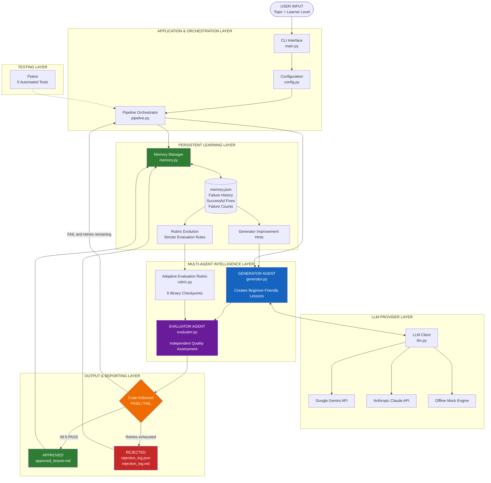

# 🧠 Self-Evolving RAG Lesson Generator
### A Multi-Agent AI System with Persistent Memory, Adaptive Evaluation & Feedback-Driven Improvement

<p align="center">
  
  
  
  
  
  
</p>

---

## 🚀 Overview

**What if an AI system could generate content, evaluate its own output, learn from previous failures, and improve its next execution?**

The **Self-Evolving RAG Lesson Generator** is a multi-agent AI application that generates beginner-friendly educational lessons, independently evaluates their quality, and iteratively improves them using structured feedback and persistent memory.

The system consists of two specialized AI agents:

- **Generator Agent:** Generates educational lessons based on the topic, learner knowledge level, and historical improvement instructions.
- **Evaluator Agent:** Independently evaluates generated lessons against six predefined quality checkpoints using strict binary PASS/FAIL decisions.

When a lesson fails evaluation, the Evaluator provides structured failure reasons. The Generator uses this feedback to improve its next attempt.

The system goes beyond ordinary retry mechanisms by maintaining persistent memory in `memory.json`. Historical failures, successful corrections, and recurring weaknesses influence future generation prompts and evaluation criteria.

**Core idea:** Build an AI workflow that uses its previous execution history to improve the quality of future outputs without requiring model fine-tuning or retraining.

## 🎯 Key Features

- **Multi-Agent Architecture:** Separate Generator and Evaluator agents with clearly defined responsibilities.
- **LLM-as-a-Judge:** Automated evaluation using six quality checkpoints.
- **Feedback-Driven Refinement:** Generates improved lessons based on structured evaluation feedback.
- **Persistent Memory:** Remembers historical failures and successful improvements across independent runs.
- **Adaptive Evaluation Rubric:** Strengthens evaluation requirements for repeatedly failing checkpoints.
- **Bounded Retry Mechanism:** Maximum of two retries to prevent uncontrolled generation loops.
- **Code-Enforced Decisions:** Final approval is calculated by Python logic, not trusted to the LLM's overall verdict.
- **Multiple LLM Providers:** Supports Google Gemini and Anthropic Claude.
- **Offline Mock Mode:** Demonstrates the complete pipeline without an API key.
- **Structured Reporting:** Generates approved lessons and detailed rejection reports.
- **Automated Testing:** Includes five pipeline test cases using Pytest.

---

## 🏗️ System Architecture

The application follows a modular multi-agent architecture consisting of six major layers:

1. Application and Pipeline Orchestration
2. Multi-Agent Intelligence
3. LLM Provider Integration
4. Persistent Memory and Adaptive Learning
5. Output and Reporting
6. Automated Testing

### Architecture Diagram



### Architecture Explanation

| Layer | Responsibility |
|---|---|
| Application Layer | Handles user input, configuration, and execution. |
| Multi-Agent Layer | Coordinates lesson generation and independent evaluation. |
| LLM Provider Layer | Integrates Gemini, Claude, and offline mock execution. |
| Memory Layer | Stores historical failures, successful fixes, and improvement hints. |
| Evaluation Layer | Applies binary checkpoints and adaptive evaluation rules. |
| Output Layer | Manages approved lessons and rejection reports. |
| Testing Layer | Validates pipeline behaviour through automated tests. |

---

## 🔄 End-to-End Execution Workflow

### Step 1: User Input

The system receives a topic and learner profile.

Example:

```text
Topic: Introduction to RAG
Learner Level: Beginner
Prior Knowledge: Zero technical knowledge
Learning Objective: Understand what RAG is,
why it is used, and how it works.
```

### Step 2: Load Persistent Memory

Before generating a lesson, the system retrieves historical execution data from `memory.json`.

It extracts:

- Previous failure reasons.
- Successful corrections.
- Frequently failing checkpoints.
- Generator improvement instructions.
- Updated evaluation requirements.

### Step 3: Generator Agent

The Generator Agent creates a structured educational lesson using:

- User-provided topic.
- Learner knowledge level.
- Generation instructions.
- Historical improvement hints.

### Step 4: Evaluator Agent

The Evaluator independently checks the generated lesson against six quality checkpoints.

It returns structured evaluation results containing:

- Checkpoint name.
- PASS or FAIL status.
- Failure reasons.
- Suggested improvements.

### Step 5: Feedback and Retry Loop

If one or more checkpoints fail, the Pipeline Orchestrator sends the evaluator's feedback to the Generator Agent.

The Generator creates an improved version.

**Retry configuration:**

- Initial generation: 1 attempt.
- Maximum retries: 2.
- Maximum total generation attempts: 3.

### Step 6: Code-Enforced Approval

The final decision is calculated programmatically.

```python
overall_result = (
    "PASS"
    if all(
        result["status"] == "PASS"
        for result in checkpoint_results
    )
    else "FAIL"
)
```

The application does not trust the LLM's self-reported overall verdict.

- All six checkpoints PASS → APPROVED.
- Any checkpoint FAIL → FAIL.
- All retries exhausted → REJECTED.

### Step 7: Update Persistent Memory

After execution, the system records relevant failures, reasons, successful corrections, and checkpoint failure counts.

This information becomes available to future executions.

---

## 🧪 Evaluation Framework

The Evaluator Agent uses six strict binary quality checkpoints.

There are no partial marks or subjective overall scores.

| Checkpoint | PASS Criteria |
|---|---|
| Accuracy | Correctly explains RAG as retrieval + LLM generation using retrieved context without confusing it with fine-tuning. |
| Beginner Friendly | Uses simple English and assumes zero prior technical knowledge. |
| Practical Examples | Includes at least two practical real-world examples. |
| Jargon Explanation | Explains technical terminology in plain language when first introduced. |
| Completeness | Covers What, Why, How, and Examples. |
| Teaching Flow | Follows Introduction → What → Why → How → Examples → Summary. |

### Why Binary Evaluation?

Traditional scoring systems can approve content even when important quality requirements are not satisfied.

This project uses strict binary evaluation to ensure that every required quality condition is met before publication.

The application, rather than the LLM, determines the final result.

---

## 🧠 Self-Evolving Memory & Adaptive Learning

The most important feature of this project is its persistent feedback-driven improvement mechanism.

Unlike conventional LLM applications that forget previous failures between executions, this system stores historical learning signals and uses them in subsequent runs.

### 1. Persistent Memory

The `memory.json` file stores:

- Historical failed checkpoints.
- Evaluation failure reasons.
- Successful corrections.
- Retry improvement details.
- Checkpoint failure counts.
- Historical execution information.

### 2. Generator Improvement Hints

Previous failures and successful fixes are converted into actionable instructions and injected into future generation prompts.

**Example:**

Previous failure:

```text
Checkpoint: beginner_friendly

Failure:
The lesson assumes that learners understand
embeddings and vector databases.
```

Successful correction:

```text
Introduce technical concepts using simple
analogies before explaining their role in RAG.
```

On the next execution, the Generator receives this improvement instruction.

### 3. Adaptive Rubric Evolution

The evaluation criteria become stricter when a checkpoint repeatedly fails.

| Historical Failures | Evaluation Behaviour |
|---|---|
| 0–1 failures | Standard evaluation criteria |
| 2 or more failures | Stricter evaluation criteria |

This mechanism helps the Evaluator pay closer attention to recurring weaknesses.

### 4. Recurring Failure Analysis

The `--show-memory` command displays stored failures, repeated weaknesses, and future improvement instructions.

### Important Technical Distinction

This system does not retrain LLM weights or perform autonomous model fine-tuning.

Its self-improvement mechanism operates at the application level through persistent memory, prompt adaptation, historical feedback, and adaptive evaluation rules.

---

## ⚙️ Technology Stack

| Technology | Application |
|---|---|
| Python | Core development and pipeline orchestration |
| Google Gemini | LLM-powered generation and evaluation |
| Anthropic Claude | Alternative LLM provider |
| Prompt Engineering | Structured generation and evaluation |
| Multi-Agent Architecture | Generator and Evaluator collaboration |
| JSON | Persistent memory and evaluation records |
| Pytest | Automated testing |
| Mock Engine | Offline pipeline simulation |

### Engineering Concepts

- Agentic AI and multi-agent workflows.
- LLM-as-a-Judge evaluation.
- Structured LLM outputs.
- Feedback-driven prompt engineering.
- Persistent application-level memory.
- Adaptive evaluation criteria.
- Retry and failure-handling mechanisms.
- Provider abstraction.
- Modular Python architecture.
- Automated testing.

---

## 📂 Project Structure

```text
rag_lesson_agent/
│
├── main.py
│
├── src/
│   ├── config.py
│   ├── rubric.py
│   ├── generator.py
│   ├── evaluator.py
│   ├── pipeline.py
│   ├── memory.py
│   ├── outputs.py
│   ├── llm.py
│   └── mock.py
│
├── tests/
│   └── test_pipeline.py
│
├── sample_outputs/
│   ├── approved_run/
│   └── rejected_run/
│
├── requirements.txt
├── memory.json
├── approved_lesson.md
├── rejection_log.json
├── rejection_log.md
└── README.md
```

### Module Responsibilities

| File | Responsibility |
|---|---|
| `main.py` | CLI entry point and execution commands |
| `config.py` | Model configuration, topic settings, retry limits |
| `rubric.py` | Six evaluation checkpoints and adaptive rubric |
| `generator.py` | Lesson generation agent |
| `evaluator.py` | Independent evaluation and binary enforcement |
| `pipeline.py` | Agent orchestration and retry loop |
| `memory.py` | Persistent memory and improvement hints |
| `outputs.py` | Approved lesson and rejection report management |
| `llm.py` | LLM provider integration |
| `mock.py` | Offline simulation |
| `test_pipeline.py` | Automated pipeline tests |

---

## 💻 Installation & Setup

### 1. Clone the Repository

```bash
git clone https://github.com/Suraj-Kumar09/rag_lesson_agent.git

cd rag_lesson_agent
```

### 2. Create a Virtual Environment

```bash
python -m venv venv
```

Activate it:

**Windows:**

```bash
venv\Scripts\activate
```

**Linux / macOS:**

```bash
source venv/bin/activate
```

### 3. Install Dependencies

```bash
pip install -r requirements.txt
```

### 4. Configure an LLM Provider

The application supports Google Gemini and Anthropic Claude.

**Option A: Google Gemini**

Generate an API key:

https://aistudio.google.com/apikey

Configure the environment variable:

```bash
export GEMINI_API_KEY="your_api_key"
```

**Option B: Anthropic Claude**

Generate an API key:

https://console.anthropic.com/

```bash
export ANTHROPIC_API_KEY="your_api_key"
```

**Windows PowerShell:**

```powershell
$env:GEMINI_API_KEY="your_api_key"
```

Never commit API keys or `.env` files to your repository.

---

## ▶️ Running the Application

### Real LLM Execution

```bash
# Automatic provider selection
python main.py

# Run with Gemini
python main.py --provider gemini --runs 3

# Run with Claude
python main.py --provider claude

# Multiple executions to observe memory evolution
python main.py --runs 3
```

### Offline Mock Execution

No API key is required.

```bash
# Run one mock execution
python main.py --mock

# Run multiple mock executions
python main.py --mock --runs 2

# Demonstrate the REJECTED path
python main.py --mock --stubborn
```

### Memory Management

```bash
# Display memory and improvement hints
python main.py --show-memory

# Reset persistent memory
python main.py --reset-memory
```

### Model Configuration

```bash
export GEMINI_MODEL="gemini-2.5-flash"
```

The application includes rate-limit handling for Gemini API requests.

---

## 📊 Demonstration Scenarios

The offline mock engine demonstrates the pipeline's behaviour without requiring external API calls.

### Scenario 1: Feedback-Driven Improvement

**Run 1**

| Attempt | Result |
|---|---|
| Initial Generation | FAIL |
| Retry 1 | PASS |
| Final Decision | APPROVED |

The initial failure and successful correction are stored in persistent memory.

**Run 2**

| Attempt | Result |
|---|---|
| Initial Generation | PASS |
| Retry Required | No |
| Final Decision | APPROVED |

The Generator receives historical improvement hints and passes on the first attempt in the configured mock demonstration.

### Scenario 2: Rejection Handling

Execute:

```bash
python main.py --mock --stubborn
```

Expected behaviour:

1. Initial generation fails.
2. Retry 1 fails.
3. Retry 2 fails.
4. Final decision becomes REJECTED.
5. Rejection reports are generated.
6. `approved_lesson.md` is deleted.
7. Failure information is saved in `memory.json`.

### Scenario 3: Automated Testing

Execute:

```bash
python -m pytest -q
```

The project includes five automated pipeline test cases covering key behaviours such as generation, evaluation, retries, rejection, and memory handling.

---

## 📁 Generated Outputs

The system generates three main categories of artifacts.

### 1. Approved Lesson

`approved_lesson.md`

Contains the final evaluated educational lesson.

This file is created only when all six checkpoints pass.

### 2. Rejection Reports

- `rejection_log.json`
- `rejection_log.md`

Contains failed checkpoints, evaluation reasons, retry attempts, and improvement details.

### 3. Persistent Memory

`memory.json`

Stores historical execution data used to improve future generation prompts and evaluation criteria.

Example output organization:

```text
sample_outputs/
│
├── approved_run/
│   ├── approved_lesson.md
│   ├── rejection_log.json
│   └── memory.json
│
└── rejected_run/
    ├── rejection_log.json
    ├── rejection_log.md
    └── memory.json
```

---

## 🔐 Reliability & Engineering Decisions

The project incorporates several important engineering principles:

**Independent Agent Responsibilities**

The Generator and Evaluator have separate roles, reducing dependence on the Generator's own assessment of its output.

**Deterministic Approval**

The final approval decision is calculated through Python logic rather than relying on an LLM-generated verdict.

**Bounded Execution**

A maximum of two retries prevents uncontrolled generation loops.

**Persistent Feedback**

Historical failures and successful corrections influence future generation prompts.

**Controlled Output Management**

Only approved lessons are published, while unsuccessful executions generate rejection reports.

**Offline Testing**

Mock execution enables reproducible demonstrations without consuming API credits.

---

## 🚀 Future Enhancements

Potential directions for extending the system:

- LangGraph integration for stateful multi-agent orchestration.
- Vector database integration for semantic memory retrieval.
- RAG-based retrieval of historical evaluation examples.
- Human-in-the-loop approval for disputed evaluations.
- Langfuse integration for LLM observability and tracing.
- Evaluation dashboards for checkpoint performance.
- Specialized agents for fact-checking and teaching quality.
- Prompt versioning and comparative evaluation experiments.

---

## 🎓 Key Learnings & Technical Takeaways

This project demonstrates practical implementation of:

| AI/ML Domain | Implementation |
|---|---|
| Generative AI | Structured educational content generation |
| Agentic AI | Generator and Evaluator collaboration |
| LLM Evaluation | Six-checkpoint binary assessment |
| Prompt Engineering | Feedback-driven prompt adaptation |
| AI Memory | Persistent failure and correction history |
| Adaptive Systems | Evolving evaluation requirements |
| Python Engineering | Modular application architecture |
| Reliability | Bounded retries and deterministic decisions |
| Testing | Offline simulation and automated tests |

---

## 👨‍💻 About the Developer

**Suraj Kumar**

AI & Machine Learning Engineer | Generative AI | Agentic AI | LLMOps

B.Tech graduate in Artificial Intelligence and Data Science with hands-on experience in Python, Machine Learning, Generative AI, LLM applications, Agentic AI, RAG, MLOps, and LLMOps.

Interested in building intelligent AI applications, multi-agent systems, reliable LLM workflows, and feedback-driven AI architectures.

### Connect With Me

- **GitHub:** https://github.com/Suraj-Kumar09
- **LinkedIn:** https://linkedin.com/in/aideveloperontop

---

<p align="center">

### ⭐ If you find this project interesting, consider giving the repository a star!

**Built to explore a fundamental question in AI engineering:**

*How can LLM-powered systems use persistent experience and structured feedback to improve future outputs?*

</p>